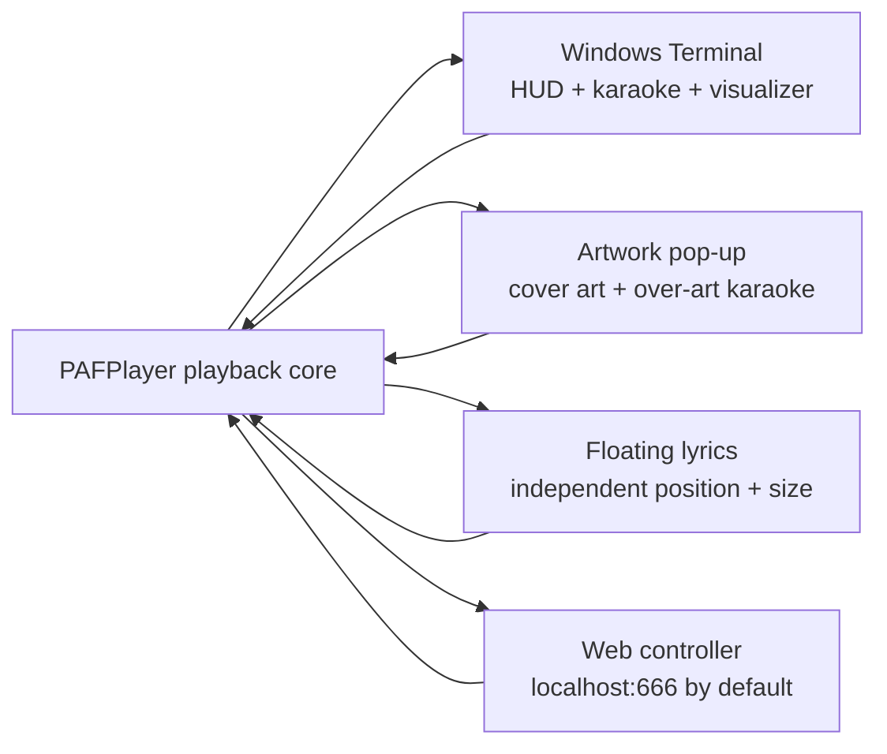
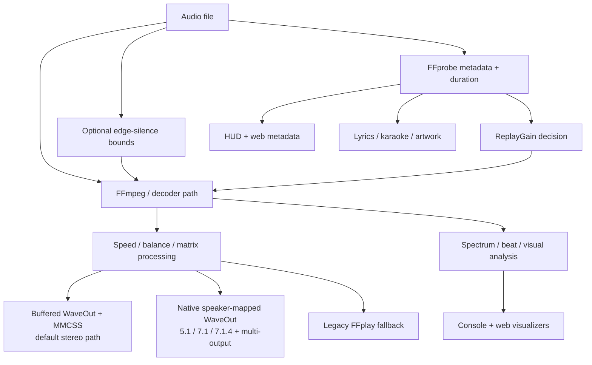
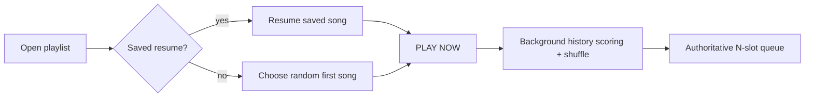

# PAFPlayer

## Current source — V581

- Ten-second Steam start/stop notices appear in the console HUD and below the
  web song title, including the game name, visualizer reduction, and idle-gallery
  restriction. They expire during paused playback and do not repeat every scan.
- [Steam configuration and manual checks](docs/steam.md).
- [V581 release notes](releases/PAFPlayer_v581_steam_activity_notices_release_notes.md).

## Previous release — V580

- [Steam configuration](docs/steam.md) defaults to half the console visualizer
  frame budget and no idle gallery while a Steam game runs. Audio is unaffected.
- [Tray Options](docs/windows-tray.md) consolidates local tray behavior. Remote
  artwork uses the player renderer, inherits server appearance, and offers
  server/on/off artwork lyrics. `--tray-only HOST:PORT` detaches from the shell;
  add `--foreground` for diagnostics.
- The requested Emoji coloring selector is recorded as a player/tray TODO.
- [V580 release notes](releases/PAFPlayer_v580_remote_tray_and_steam_release_notes.md)
  and [manual verification](docs/PAFPlayer_v580_remote_tray_and_steam_manual.md).

## Earlier release — V579

- Embedded `--unit-tests`, standalone `unittest` methods, and in-process
  pytest calls to `main()` now run without acquiring or forwarding to the
  live official instance. Their
  temporary playlists cannot replace the household player's queue. The test
  path also disables its tray icon and ownership-claim watcher.
- See the [V579 release notes](releases/PAFPlayer_v579_test_instance_isolation_release_notes.md).

## Earlier release — V578

- Playlist successor preparation now predicts the normal forward handoff after
  shuffle rotation and recent-play cooldown. It also respects manually queued
  tracks, resume successors, and forward visit history. File and history checks
  run in the background, outside the playback owner thread. See
  [playback controls](docs/playback-controls.md).
- See the [V578 release notes](releases/PAFPlayer_v578_successor_prediction_release_notes.md).

## Earlier release — V577

- A tray-only computer can save the current source audio file through a native
  Save As dialog with progress and per-server destination history. The download
  is bound to the official owner and one track visit, and never overwrites a
  destination. See [Windows tray](docs/windows-tray.md).
- `--setup-ffmpeg HTTPS-ZIP-URL EXPECTED-SHA256` offers an explicit private
  installation without editing PATH. See [FFmpeg setup](docs/ffmpeg-setup.md).
- Playlist playback prepares likely successor metadata, silence bounds, and
  console cover art in the background. The Vial / Grow Up metadata HUD aligns
  Album with the Play path, and Emojimaxx leaves `graveyard` and `fried` alone.
- The Experimental custom frequency editor now explains source frequency
  percentiles versus display width and retains named profile controls. See
  [Web configuration](docs/web-config-playback.md).
- See the [V577 release notes](releases/PAFPlayer_v577_remote_save_setup_release_notes.md).

## Earlier release — V576

- Progress Bar Web Config now offers independent gradient order and palette
  inversion plus a beat color overlay. The existing color mode IDs stay stable.
- A standalone time such as `PAFPlayer 1:30` or `PAFPlayer -5s` seeks the
  already-running official player through its authenticated instance channel.
- A half-screen rainbow DRCS title has 25 designs. Experimental Web Config can
  select one, test it for five seconds, or hold it while its dropdown is open.
- The startup resume line has a leading alignment space; the MonkeyMote startup
  line shows its listening address without the client-limit parenthetical.
  MonkeyMote still accepts multiple clients; see [its guide](docs/monkeymote.md).
- See the [V576 release notes](releases/PAFPlayer_v576_progress_seek_title_release_notes.md).

## Earlier releases — V575 and before

- V575 also brightens dark volume rainbow colors; see [playback controls](docs/playback-controls.md).
- V574 stabilizes remote Floating Lyrics, restores enabled windows reliably,
  fixes Whip Emojimaxx font fallback and cleans up Tk/tray shutdown. See the
  [remote lyric guide](docs/remote-floating-lyrics-v574.md).
- The web/remote-tray port is configurable with `--web-port=7777`; connect with
  `--tray-only HOST:7777`. The default remains 666.

## Previous release — V573

- Floating Lyrics now recovers leaked Windows-1252 lyric controls such as U+0089 as printable characters (`‰`). Sidecar decoding also recovers legacy Windows-1252 bytes without modifying lyric files. See [Floating Lyrics documentation](docs/floating-lyrics.md) and [V573 release notes](releases/PAFPlayer_v573_lyric_character_recovery_release_notes.md).

## Previous release — V572

- The web configuration has a **Last.fm** tab with profile and forced scrobble actions. These controls are separate from Metadata / Maintenance and use the existing playback action and profile routes. See [web configuration notes](docs/web-config-playback.md) and [V572 release notes](releases/PAFPlayer_v572_lastfm_web_tab_release_notes.md).

## Previous release — V571

- Rewrote 241 source-only release entries from archived code diffs and version-specific checks. The history now describes behavior and implementation, and marks gaps, version-only changes, and the V472 integration script. See [the complete changelog](PAFPlayer_changelog.md) and [V571 release notes](releases/PAFPlayer_v571_code_verified_release_history_release_notes.md).
- This documentation release leaves playback behavior at the V569 build.

## Earlier release — V570

- Reconstructed the V1–V569 index from surviving releases, notes, and backups, then organized generated reports and root backups. V571 improves the source-only descriptions.

## Earlier release — V569

- Fix the repeated tray lyric popup `ctypes.ArgumentError` while paused.
  Private Windows API bindings prevent wallpaper and popup calls from changing
  each other's argument types; failed lyric attempts no longer repeat every tick.
  See [the tray fix and verification guide](docs/tray-popup-v569.md).
- **Simultaneous multiple MonkeyMote clients:** up to eight existing phones or
  tablets can connect and control the official player at once.
- MonkeyMote compatibility is enabled by default. A **MonkeyMote** web tab near
  the bottom shows the listening address, port (normally **19371**), and client
  count. Disable temporarily, or confirm a permanent disable.
- Change the listening port during playback, with a popup choosing **This run
  only**, **Save for future runs**, or **Cancel**. `--monkeymote-port=PORT` is a
  per-run command-line override; legacy `--monkeymote-config FILE` still works.
- Current track/state, Play/Pause, Previous/Next, volume, upcoming playlist order
  and selection, current artwork, future-track Details and lyric text are
  supported. Core playback/media features are verified on MonkeyMote HD iPad;
  the user also confirmed two simultaneous physical clients and working lyrics
  in V568. Android-specific behavior remains unverified.
- Official-owner command routing, bounded per-client workers, shared transport
  backlog prevention, and private home-subnet restriction remain in place.
  MonkeyMote traffic is unencrypted; discovery and full library browsing are
  not implemented. Artist/genre drill-down currently returns an empty result.

See [the MonkeyMote guide](docs/monkeymote.md) for configuration, limitations,
verification evidence, and the two-device manual test.

## Historical release — V564

V564 adds a deliberately small open remote-control API for a phone, tablet, or
homescreen widget. This matches the open-player design: no secret or account
setup is required.

Available endpoints:

- `GET /api/remote/status` — current player status.
- `POST /api/remote/pause` — pause/toggle pause.
- `POST /api/remote/resume` — resume playback.
- `POST /api/remote/toggle-pause` — toggle pause state.

Mutating endpoints return `202` when the command is accepted and `503` when
the player cannot accept it yet. Keep the API on a trusted LAN/VPN or behind
an HTTPS reverse proxy; PAFPlayer does not provide TLS or authentication.

See [the remote-control API guide](docs/remote-control-api.md).

## Historical release — V520

**Source:** `PAFPlayer.py`  
**Snapshot:** `releases/PAFPlayer_v520_lock_screen_album_and_counter.py`  
**Build ID:** `2026-10-10-v520-lock-screen-album-playback-counter`  
**Updated:** 2026-10-10

V520 adds album and elapsed/total time to lock-screen detailed status. Its rows are
artist — song, `1:01 / 2:00 · Album`, and the current lyric. The middle row replaces
the previous lyric when album/time is available. The quick-status icon remains a
playback-state badge. Counters use actual playback time; lyrics retain V519's
250 ms lead. Unchanged whole seconds do not generate extra counter updates.

V519's visualizer output reduction is retained (42–64% fewer bytes in identical-frame
benchmarks; actual gaming FPS unverified). All main-player functions/classes and
native renderer data match V519. The signed V520 companion is installed; relaunch
the still-running V518 player with V520 to load these changes.

183 focused checks passed, along with compilation, package validation, signatures
and interactive notification publication. The preceding full V518/V519 comparison
ran 678 tests per version with identical 614 passes, 51 failures and 13 errors.
V520 does not claim those existing suite failures are fixed. Locked-screen visual
appearance and in-game FPS still require the manual checks.

See [V520 release notes](releases/PAFPlayer_v520_lock_screen_album_and_counter_release_notes.md),
[V520 manual snapshot](docs/PAFPlayer_v520_lock_screen_album_and_counter.md),
[lock-screen guide](docs/windows-lock-screen.md), and
[performance measurements](docs/performance-v519.md).
The [visual screensaver](docs/visual-screensaver.md) remains separate.
UAC and play_audio_file.py are unchanged. No literal C:\BAT paths changed.

## Historical comprehensive manual — V448

**Historical release:** PAFPlayer V448  
**Build ID:** `2026-09-24-v448-playback-config-layout`  
**Historical source name:** `PAFPlayer.py` / `PAFPlayer_v448.py`  
**Updated:** 2026-09-24  
**Platform:** Windows-first; Windows Terminal is the intended console host.

> The V448 material below is historical coverage. For current behavior, use the current source and the linked project documentation and release notes above.

---

## What PAFPlayer is

PAFPlayer is a Windows-first music player that treats the terminal, artwork window, floating-lyrics window, and browser page as four coordinated views of one player. It is not just a wrapper around FFplay anymore. V448 combines its own buffered Windows audio path, FFmpeg/FFprobe analysis, playlist/history logic, Last.fm integration, karaoke, EmojiMaxx, console visualizers, artwork compositing, a persistent web controller, speaker-expansion matrices, and multi-output playback.

PAFPlayer is designed around one principle: **music should keep playing while expensive work happens elsewhere**. Playlist history scoring, shuffling, metadata work, artwork work, Last.fm network calls, visual analysis, and most GUI work are moved off the critical playback path whenever possible.

### The four user surfaces



The **terminal** is the primary keyboard-driven interface. The **artwork pop-up** is a persistent movable/resizable cover-art surface with optional karaoke. **Floating Lyrics** is a separate lyric-only window. The **web controller** exposes transport, configuration, artwork, karaoke, visualizer, speaker expansion, and diagnostics in a browser.

---

# 1. Quick start

The documentation uses the modern program name `PAFPlayer.py`. Some compatibility strings inside the source and its built-in usage screen still say `play_audio_file.py`; those are historical names, not a second product.

```text
python PAFPlayer.py C:\mp3\Artist\Album\Song.mp3
python PAFPlayer.py --playlist C:\mp3\lists\favorites.m3u
python PAFPlayer.py C:\mp3\lists\favorites.m3u
python PAFPlayer.py --random-file C:\mp3\PUNK
python PAFPlayer.py --random-file-recursive C:\mp3
python PAFPlayer.py --simple C:\mp3\Artist\Album\Song.mp3
python PAFPlayer.py --version
python PAFPlayer.py --unit-tests
```

If `C:\mp3` does not exist on first Windows use, PAFPlayer can ask where the real music collection lives and establish the expected `C:\mp3` / `C:\music` aliases and `C:\mp3\lists` structure without silently replacing existing paths.

### Core external tools

PAFPlayer expects FFmpeg-family tools to be available in `PATH` for full operation: `ffmpeg`, `ffplay`, and `ffprobe`. Chafa is used for console artwork when available. Python packages are loaded opportunistically: `mutagen` expands metadata/art/embedded-lyric support; `wcwidth` improves terminal-width accounting; `pyaudiowpatch` is used for selected WASAPI loopback/microphone features. Claire helper modules can live in `C:\clairecjs_utils`, an importable package location, beside PAFPlayer, or in its supported helper subfolder.

---

# 2. Mental model: one player, several pipelines



The audio path and presentation path are deliberately separate. Turning on artwork, web controls, karaoke, or visualizer effects should not change the underlying track identity/history semantics. Likewise, visualizer features do not rewrite the music.

---

# 3. Audio playback

## 3.1 Default stereo renderer

V447 defaults to **Smooth Audio**, PAFPlayer's buffered Windows WaveOut renderer with an MMCSS audio pump. The normal safety reservoir is **250 ms**. Its purpose is to protect playback from short CPU/GIL/UI spikes while avoiding the much larger latency of older experiments. Pause/resume uses a shorter one-shot reservoir so Space does not wait for the entire normal buffer to refill.

Use:

```text
--smooth-audio
--legacy-ffplay-audio
--audio-buffer-ms=MS
```

The legacy FFplay path remains available as a fallback and diagnostic comparison.

## 3.2 ReplayGain

ReplayGain is enabled by default in **track-preference** mode:

```text
--replaygain=track
--replaygain=album
--replaygain=off
```

Track mode prefers track gain and falls back to album gain; album mode reverses that preference. ReplayGain is playback-time normalization. It does **not** bake gain into the source file. PAFPlayer constrains positive gain when peak data says the requested boost would clip.

## 3.3 Edge-silence trimming

Edge trimming is on by default. It is deliberately conservative and only targets sufficiently quiet audio at the **beginning and end** of a track; it does not remove silence in the middle.

Current defaults:

| Setting | Default |
| --- | ---: |
| Silence threshold | `-43 dBFS` |
| Minimum continuous quiet | `0.35 s` |
| Quiet material retained at boundary | `0.08 s` |
| Maximum scan from each edge | `60 s` |

Useful switches:

```text
--trim-edge-silence
--no-trim-edge-silence
--trim-silence-threshold-db=-43
--trim-silence-min-duration=0.35
--trim-silence-keep=0.08
```

## 3.4 Volume, speed, balance

The most important controls are:

| Control | Action |
| --- | --- |
| `Up / Down` | volume ±5% |
| `Shift+Up / Shift+Down` | volume ±20% |
| `Ctrl+Alt+Up / Ctrl+Alt+Down` | global PAFPlayer volume hotkeys |
| `+ / -` | playback speed |
| `=` | reset volume to 100% **and** speed to 1× |
| Numpad balance controls | move/center balance where supported |

Speed is reset to 1× at startup, playlist load, and after successful INS additions.

## 3.5 Stereo, 5.1, 7.1, and 7.1.4

`2`, `5`, and `7` select stereo, 5.1 expansion, and 7.1 expansion. The web UI also exposes **Dolby Atmos 7.1.4** where the Windows/HDMI endpoint can accept it.

The multichannel renderer is not a generic “duplicate stereo everywhere” switch. PAFPlayer maintains an editable **Speaker Expansion Matrix** with per-speaker left/right coefficients, subwoofer crossover, persistent mutes, named profiles, and final-PCM level meters. The native Windows path uses explicit speaker mapping so channel edits reach the intended physical channels.

### Speaker Expansion Matrix

The web controller contains an editor for:

- 5.1
- 7.1
- Dolby Atmos 7.1.4
- per-speaker mute state
- per-speaker L/R coefficients
- sub crossover
- named profiles
- restore-to-factory per section

## 3.6 Multiple simultaneous output devices

PAFPlayer can select more than one WaveOut endpoint. The **Multi-Out Latency** dialog provides per-endpoint timing from **−2000 ms to +2000 ms**. Positive values delay that endpoint. A negative value means “make this endpoint earlier relative to its peers,” implemented by delaying the other outputs because audio cannot be sent into the past.

An experimental microphone-assisted acoustic auto-sync mode can emit test tones and estimate relative delay.

## 3.7 Other media takes priority

V447 can automatically pause PAFPlayer when **new** VLC, Winamp, or browser playback becomes active. Existing background media at PAFPlayer startup is ignored. Once the other media is quiet, PAFPlayer can resume with a configurable fade; the default is **15 seconds**.

The optional loudness matcher can use recent clean measurements to adjust PAFPlayer's resumed volume to resemble the external media. It requires sufficient clean samples and leaves volume unchanged if the measurement is ambiguous or contaminated.

The relevant web Playback controls are:

- **Pause for VLC, Winamp and browser media**
- **Match external playback loudness**
- **Automatic resume fade-in**

### V448 Playback configuration layout

The Playback section is deliberately grouped into four visual rows:

1. **Device → Channels → Speaker Expansion Matrix → Disable speaker expansion**
2. **Rate + bit depth → Playback speed → Balance**
3. **Pause for VLC/Winamp/browser media → Match external playback loudness → Automatic resume fade-in**
4. **Visualizer input**

The rows remain flex-wrapped on narrow browser windows, so the semantic order is preserved even when a row has to wrap. **Multi-Out Latency** remains conditionally visible next to the Device control when multiple outputs make it relevant.

### V447 audio safety fix

V446 contained a serious endpoint-probe bug: a COM vtable index intended to read mute state called `SetMute` instead of `GetMute`, which could mute every active Windows render endpoint and therefore silence browsers as well as PAFPlayer. V447 corrects the probe to call `GetMute` and contains a regression guard for that mistake.

---

# 4. Transport and navigation

| Key | Current behavior |
| --- | --- |
| `Space` | pause/resume |
| `< / >` | previous/next track |
| `{ / }` | previous/next directory containing audio |
| `Left / Right` | seek −/+5 s |
| `Shift+Left / Shift+Right` | seek −/+15 s |
| `Ctrl+Left / Ctrl+Right` | seek −/+60 s |
| `PgUp / PgDn` | browse previous visits / future playlist; Enter jumps |
| `J`, `INS`, or bare `Q` | open audio search/queue picker |
| `Shift+INS` | Windows multi-select file picker; add and queue next |
| `DEL` | remove current entry from playlist after confirmation; never deletes the audio file |
| `Ctrl+O` | choose a different playlist and cleanly relaunch it in the same console |
| `Ctrl+R` / `Ctrl+Alt+R` | reread playlist, reload lyrics, rebuild shuffle/cache |
| `QQQ` | quit from the Q command flow |
| `Ctrl+Q`, `Alt+Q`, `Ctrl+Alt+Q` | immediate quit |
| `X`, `Ctrl+W`, `Alt+F4`, `Ctrl+C`, `Ctrl+Break` | immediate stop/exit path |

Media Previous/Next keys have separate seek/track semantics depending on modifiers; the built-in `?`/F1 help is the best place to check the exact modifier combination while running.

---

# 5. Playlist mode: no waiting in silence

Playlist startup follows this order:

1. Read the playlist file into an N-slot working set.
2. If a saved resume track exists, start there.
3. Otherwise choose a starting track randomly.
4. **Start playback immediately.**
5. Score history and build the authoritative history shuffle on a session-scoped background thread.
6. Never cancel that shuffle merely because the song changes.



This is intentional: PAFPlayer should not make you wait silently for a large history shuffle before the first song begins.

## 5.1 History-biased shuffle

The normal history shuffle is:

- one randomized **Never / unknown-history bucket** first;
- followed by **10 known-history deciles**, oldest to newest;
- randomized within each bucket/decile.

The V448 source keeps the old 3-hour “recent visit avoidance” machinery behind `SHUFFLE_RECENT_AVOID_ENABLED`, but that switch is **off by default**. Some older help text still mentions the old 3-hour behavior; the V448 code is authoritative.

## 5.2 Persistent shuffle cache

A completed shuffle can be reused for up to **5 hours** by default. Queue rotation does not reset the original cache age. Writes are coalesced asynchronously so a cache write does not compete with the next song's audio startup.

## 5.3 INS is a real play-next queue

INS/Shift+INS additions are both playlist edits and explicit **play-next** requests. They are kept separately from the long-lived history shuffle until they have played. If several tracks are added while shuffle is active, those manually requested tracks are randomized **among themselves**, but ordinary shuffle does not jump ahead of them.

## 5.4 Live playlist edits are protected against stale workers

PAFPlayer uses runtime addition overlays and deletion tombstones so a slower background loader cannot accidentally resurrect a track you removed or erase a track you just added. `Ctrl+R` performs a true disk reread and rebuild.

---

# 6. Search, playlist browser, and tags

## Search / queue picker

`J`, `INS`, or bare `Q` opens the search interface.

- `Enter`: queue selected result(s)
- `Shift+Enter`: jump directly
- `Ctrl+Space`: multi-select rows
- `Shift+INS`: use the Windows picker instead

The master catalog is prepared in the background. Large collections avoid doing filesystem work on every keystroke.

## Playlist browser

`PgUp` / `PgDn` opens the visit/future browser. Navigation keys move the selection, Enter jumps to the selected track, and Esc closes it.

## Tag view

`Alt+3` opens the live tag view. It updates as tracks change, prioritizes HUD-equivalent fields, translates common metadata/ID3 identifiers, and keeps each field to one terminal row. `PgUp/PgDn` pages it; `Alt+3`, Esc, or Q returns to the normal HUD.

---

# 7. Local history and Last.fm

PAFPlayer deliberately separates **local Last play** from a **Last.fm scrobble**.

- Local history is earned after **one third (33⅓%)** of the unique track timeline has genuinely been heard.
- Last.fm normally requires **more than 50%**.
- Repeated seeking over the same segment does not manufacture progress because heard ranges are merged.
- A clean natural EOF can count as conclusive local-history evidence when malformed duration metadata makes the percentage threshold unreachable.
- Last.fm **Now Playing** is sent once at the beginning of a logical track visit and is not itself a scrobble.

`Ctrl+Alt+S` force-writes local history and requests a Last.fm scrobble. A visit already scrobbled requires a confirming second press before a duplicate is forced.

The historical local database filename remains:

```text
C:\bat\play_audio_file-play-history.sqlite3
```

That old filename is retained for **data compatibility**; renaming a Library artifact does not migrate the database or split decades of history.

---

# 8. Terminal HUD

The HUD is not ordinary wrapped console output. It is a width-aware layout engine that tries to maximize information density while keeping important colon stops aligned when space permits.

Typical fields include:

- Act / Artist
- Song
- Album
- Year
- Genre
- Comment
- Composer
- URL
- Last play
- playback path / state
- ReplayGain and optional diagnostic rows

`Ctrl+Alt+Numpad1` toggles smart HUD packing/alignment for the current session. `Ctrl+Alt+/` toggles extra ReplayGain/playlist/effective-tag detail rows borrowed from visualizer space.

`F5` toggles the 1-second FPS HUD and redraws. `Ctrl+Alt+F` toggles floating lyrics; the visualizer performance overlay remains available from the web controls.

---

# 9. Console visualizer

The console spectrum targets **120 Hz presentation** while its FFT analysis remains much lower-rate (normally 30 Hz). PAFPlayer interpolates presentation frames, suppresses duplicates, and adapts when the terminal cannot sustain the target.

Current defaults include:

- DRCS visualizer: on
- SIXEL visualizer: off
- target presentation rate: 120 fps
- analysis rate: 30 Hz
- top visualizer rows hidden: 1
- default persistence: Waterfall Smear
- default granularity: Twin DRCS
- frequency warp: off / experimental

The renderer explicitly anchors rows to terminal column 1, suppresses autowrap during paints, and can use synchronized-output commits to reduce tearing.

### Main visualizer controls

| Control | Action |
| --- | --- |
| `V / Shift+V` | next/previous visualizer mode |
| `F6 / F7` | glyph style |
| `Shift+F6 / Shift+F7` | visualizer treatment |
| `Alt+F6 / Alt+F7` | processing style |
| `Shift+F4` | granularity |
| `C / Shift+C` | palette next/previous |
| `C`, then number | jump to palette number |
| `C`, then `?` | palette catalog |
| `Alt+Shift+C` | reverse palette |
| `Ctrl+G / Ctrl+Shift+G` | persistence next/previous |
| `Alt+G` | persistence favorites |
| `Ctrl+Alt+G` | toggle current persistence favorite |
| `Ctrl+Alt+F8` | use blank karaoke rows for visualizer |
| `Ctrl+Alt+F9` | experimental frequency warp |
| `Shift+F10` | experimental karaoke-over-visualizer overlay |

### Artwork inside the visualizer

The web controller can independently enable artwork in:

- filled bars
- black/background cells
- karaoke-side regions
- karaoke regions (experimental)

Microtile detail modes range from simple per-cell color through quadrant/sextant/octet and adaptive hybrid modes. The current default is a 2×4 exact hybrid mode with Unicode mosaics allowed where needed. The `--no-microtile-detail...` switches force simpler single-character detail for diagnostics.

---

# 10. Karaoke, lyrics, EmojiMaxx, and de-censoring

PAFPlayer can display timed lyrics in the console, over artwork, in the floating-lyrics window, and in the browser. Sidecar formats and embedded lyric metadata are both supported where the installed metadata stack permits it.

`Ctrl+E` opens exact-stem lyric/subtitle sidecars. `D` finishes an edit cycle by reloading the files and attempting embedded lyric write-back/read-back verification.

## Karaoke controls

| Control | Action |
| --- | --- |
| `F2 / F3` | previous/next karaoke style |
| `Shift+F2 / Shift+F3` | previous/next treatment |
| `F4` | EmojiMaxx on/off |
| `Ctrl+Numpad+ / Ctrl+Numpad-` | adjust karaoke offset where supported |

PAFPlayer keeps a track-local karaoke timing offset and can offer to bake timing changes into timed lyric data/metadata at the end of the song.

## EmojiMaxx

EmojiMaxx replaces selected lyric words/phrases with semantic emoji or symbols while preserving special terminal-width behavior needed by Windows Terminal. Mappings are curated, and low-quality/ambiguous substitutions are deliberately removed rather than treated as a goal in themselves.

**V516–V518 change:** low-value `answer`, `job`, `creep`, `halo`, `speck`, `goddamn`, `fund`, `talent`, and `sneak` substitutions were removed. `guys` now uses a people-group symbol without a handshake sequence. There is no exact `lightly` mapping; nearby `light`, `slightly`, and compound-word mappings remain unchanged.

The Console Loop control now reports explicit modes such as `Repeat track`, `Repeat current folder`, `Repeat playlist`, and `Repeat OFF` instead of the ambiguous generic `Loop enabled` wording.

The `cut` Emojimaxx scissors substitution receives a terminal-only safety space so the following word remains visibly separated in Windows Terminal. Web and desktop lyric surfaces retain the original replacement text.

**V447 change:** `beast` / `beasts` are explicitly excluded from EmojiMaxx.

The CLI preview is useful for testing substitutions without playing music:

```text
python PAFPlayer.py --emojimaxx "your sample lyric here"
```

It prints the ordinary transformed form and a Windows-Terminal double-height preview.

## De-censoring

De-censoring is display-only and off by default. The three destinations are independently controllable:

- Console Karaoke
- Artwork lyrics
- Floating lyrics

The browser has its own web-karaoke de-censor control as well. The mechanism restores profanity only when it recognizes supported asterisk-masked forms; it does not rewrite the source lyric file merely because display de-censoring is enabled.

---

# 11. Artwork pop-up

The artwork pop-up is a persistent Tk window. It is hidden when no usable art exists and can reappear automatically on a later song with art.

Important current behavior:

- changing tracks/art does **not** resize the popup;
- complete artwork is contained without cropping;
- unused aspect-ratio gutters are transparent;
- position and manually chosen size persist;
- ordinary resize is free-form;
- hold **Ctrl while resizing** to force a square;
- the monitor-scaled grab border is shown while the window is focused;
- Ctrl+wheel / Ctrl− / Ctrl= changes over-art lyric size;
- active art can crossfade among related images;
- idle art/gallery behavior is separate from active playback behavior.

The web controller exposes the artwork controls in this order:

1. **⬆ Bring to top** — one-time raise without changing persistence
2. **📌 Always on top** — persistent topmost state
3. **🎨 Configure artwork karaoke**
4. **De-censor profanity**
5. Popup Karaoke enable/disable

`Alt+A` or `Ctrl+Alt+Numpad8` toggles the artwork window. `Ctrl+Alt+A` brings it to the foreground. `Ctrl+Alt+I` manually starts the idle artwork routine after its input grace period.

Artwork lookup can use embedded art, exact-stem sidecars, conventional cover/back/disc/inlay images, and selected cache fallbacks according to the track/folder rules. Missing-art downloading is explicit, not automatic: `Ctrl+Alt+D` downloads when art is missing; otherwise that key retains its visualizer-related behavior.

---

# 12. Floating Lyrics

Floating Lyrics is a genuinely separate destination, not merely artwork karaoke with the image hidden.

When you reveal/click it for editing, the window becomes opaque enough to work with and grows a thick border so it is easy to grab. You can drag it, resize it from the border, and then return to its normal presentation state.

Current controls include:

- **⬆ Bring to top**
- **📌 Always on top**
- **💬 Configure floating lyrics**
- **De-censor profanity**
- `Ctrl+mousewheel` for manual text sizing
- **Autosize** to fit each sung line as large as possible within the current box
- persistent justification, position, size, color/treatment settings, and topmost state

`Alt+F` or `Ctrl+Alt+Shift+F` toggles floating lyrics.

---

# 13. Web controller

The web server is enabled by default on:

```text
http://127.0.0.1:666/
```

The default bind is loopback-only. Using `0.0.0.0` explicitly exposes the controller to other clients allowed by the host firewall/network and should be treated as a trusted-LAN decision; PAFPlayer does not add TLS/authentication merely because you change the bind address.

Useful CLI switches:

```text
--web-server
--no-web-server
--web-host=127.0.0.1
--web-port=666
```

### Main web sections

The present V448 page is organized around functional groups rather than one giant flat control panel:

- Playback / transport
- Artwork and current-track information
- Web Karaoke
- Artwork Pop-Up
- Floating Lyrics
- Console Karaoke
- Console Visualizer
- Progress Bar
- Speaker Expansion Matrix
- Multi-Out Latency
- Experimental
- metadata / maintenance actions

The web page is a controller for the same playback owner used by the keyboard. HTTP request threads queue semantic actions rather than directly taking over track state.

---

# 14. Saved settings, defaults, and undo

Command-line switches are **session-only** unless a feature explicitly says otherwise. Persistent choices are stored through PAFPlayer's settings layer, historically under the registry branch:

```text
HKEY_CURRENT_USER\Software\ClaireCJS\play_audio_file
```

That branch retains the old product name for compatibility with existing settings. Renaming it casually would make a mature installation appear to “forget” years of preferences, so the documentation treats it as a compatibility identifier rather than a user-facing product name.

Important controls:

| Control | Action |
| --- | --- |
| `*` | saved-default manager |
| `* → R → A` | restore all saved defaults |
| `Ctrl+Alt+F1` | restore all saved defaults directly |
| `Alt+F1` | undo the most recent defaults restore |
| `Ctrl+Z` | undo runtime setting changes, repeatedly, from the in-session undo stack |

---

# 15. Console Alerts and maintenance

The web settings include a master **Console Alerts** switch and individual warnings for things such as:

- missing ReplayGain
- missing artist/title
- missing karaoke/lyrics
- missing artwork
- unknown year/genre
- embedded lyrics differing from sidecar lyrics

The ReplayGain alert is intentionally more persistent than one-shot metadata notices.

Claire-specific attribute-management features can be disabled for a run with:

```text
--suppress-attribute-management
```

`Alt+L` toggles the effective learned state quickly. `Ctrl+Alt+L` runs the richer learned/extras workflow. `Ctrl+A` opens the applicable `attrib.lst` path according to local/inherited rules.

---

# 16. Files, logs, and compatibility paths

Important current locations include:

| Purpose | Path / location |
| --- | --- |
| Error log | `C:\logs\PAFPlayer\errors.log` |
| Trace log | `C:\logs\PAFPlayer\trace.log` |
| Error/trace rollover | one `.bak` generation at 100 MiB |
| Internal play history | `C:\bat\play_audio_file-play-history.sqlite3` |
| Default catalog | `C:\mp3\lists\everything.m3u` |
| Catalog fallback | `C:\mp3\filelist.txt` |
| Global base attributes | `C:\mp3\mp3-base-attributes.lst` |
| Winamp-compatible now-playing text | `C:\mp3\lists\winamp_now_playing.txt` |
| Winamp-compatible now-playing art | `C:\mp3\lists\winamp_now_playing.jpg` |
| Preferred private emoji font | `C:\util\fonts\seguiemj.ttf` |

The remaining `play_audio_file` strings in persistence paths are compatibility names. The **Library/document/source artifact naming** is PAFPlayer; old storage identifiers should be migrated only with an explicit data migration plan.

---

# 17. Diagnostics and special modes

Useful diagnostic commands include:

```text
python PAFPlayer.py --version
python PAFPlayer.py --unit-tests
python PAFPlayer.py --emoji-display-test
python PAFPlayer.py --emojimaxx "text"
python PAFPlayer.py --emoji-symbol-survey
python PAFPlayer.py --hud-layout-survey
python PAFPlayer.py --speaker-test-5.1
python PAFPlayer.py --speaker-test-7.1
python PAFPlayer.py --speaker-test-suite
python PAFPlayer.py --last-played REGEX
python PAFPlayer.py --display-last-played-date-for-playlist playlist.m3u
```

`--simple` / `--light` is the useful “strip the fancy stuff away” diagnostic preset: it disables console/popup art, the web server, now-playing sidecar output, and visualizers for that process.

---

# 18. Troubleshooting

## No audio anywhere after starting an older V446 build

Exit V446 completely, unmute the affected Windows render endpoint(s), and use V447 or newer. V446's endpoint probe could mute the system outputs themselves, which is why browsers could go silent too. V447 fixes that probe.

## PAFPlayer audio is choppy under heavy visuals

Try, in order:

1. confirm Smooth Audio is enabled;
2. increase `--audio-buffer-ms` moderately;
3. turn off console artwork or visualizer components temporarily;
4. use `--simple` to establish an audio-only baseline;
5. compare `--legacy-ffplay-audio` as a diagnostic, not automatically as the preferred permanent solution;
6. use F5 / the performance HUD to determine whether the terminal renderer is the bottleneck.

## Visualizer tears or looks horizontally shifted

The current renderer already uses absolute column-one anchoring, autowrap suppression, explicit row movement, synchronized-output support, and several transport modes. If a regression appears, capture the active transport/microtile mode and F5/performance data rather than assuming the FFT itself is slow.

## Playlist startup appears to be “shuffling forever”

Playback should already have begun. The initial song is selected/resumed before historical scoring completes. The background status can continue across track changes; that is expected. Silence while waiting for the shuffle is not.

## `Last play: Never` disagrees with known history

The current design uses a canonical SQLite history source plus repaired Artist+Song/duration/filename identity paths. A provisional lookup should not be treated as a definitive Never. Use `--last-played REGEX` or playlist history analysis to inspect the stored match.

## Artwork or lyrics window is hard to grab

Reveal/focus the window. Floating lyrics enters an opaque thick-border editor state specifically so it can be moved/resized. The artwork border is focus-visible and DPI-scaled.

---

# 19. Current control cheat sheet

This is intentionally the **high-value** set, not every experimental chord.

| Area | Keys |
| --- | --- |
| Help | `?` or `F1` |
| Pause | `Space` |
| Track | `<` / `>` |
| Seek | arrows; Shift=15s; Ctrl=60s |
| Search / queue | `J`, `INS`, bare `Q` |
| File picker add | `Shift+INS` |
| Playlist browse | `PgUp` / `PgDn` |
| Remove playlist entry | `DEL` |
| Reload playlist + lyrics | `Ctrl+R` / `Ctrl+Alt+R` |
| New playlist | `Ctrl+O` |
| Speed | `+` / `-` |
| Reset volume + speed | `=` |
| Volume | `Up` / `Down`; Shift for ±20% |
| Output layout | `2` / `5` / `7` |
| Karaoke style | `F2` / `F3` |
| Karaoke treatment | `Shift+F2` / `Shift+F3` |
| EmojiMaxx | `F4` |
| Visualizer mode | `V` / `Shift+V` |
| Palette | `C` / `Shift+C` |
| Persistence | `Ctrl+G` / `Ctrl+Shift+G` |
| FPS | `F5` |
| Performance overlay | Web visualizer control |
| Artwork popup | `Alt+A` |
| Raise artwork | `Ctrl+Alt+A` |
| Floating lyrics | `Alt+F` / `Ctrl+Alt+F` |
| Edit lyrics | `Ctrl+E`, then `D` when finished |
| Tag view | `Alt+3` |
| Force history + scrobble | `Ctrl+Alt+S` |
| Undo runtime setting | `Ctrl+Z` |
| Quit | `QQQ`, `Ctrl+Q`, `Alt+Q`, or `Ctrl+Alt+Q` |

For the full current key matrix, press **? / F1 inside PAFPlayer**. That runtime help is generated from the same source tree and is the right place for obscure experimental chords.

---

# 20. What “current documentation” means now

The Library should use **PAFPlayer** as the user-facing artifact name. `PAFPlayer.md` is the canonical current manual. Historical manuals remain useful for design archaeology and regression tracing, but they are named by PAFPlayer version and are no longer concatenated into the current manual.

The old name still appears in some **internal compatibility identifiers**—notably the registry branch, history database filename, and a few source-level function/CLI strings. Those do not mean the product is still named `play_audio_file`; they are retained because changing persistent identifiers without migration can lose settings/history or break scripts.

---

# 21. V448 release note

V448 is a focused web-configuration layout release on top of V447:

- rearranges Playback controls into four explicit semantic rows matching the requested workflow;
- keeps the conditional **Multi-Out Latency** button associated with Device;
- preserves the V447 Windows endpoint `GetMute` safety fix and the `beast` / `beasts` EmojiMaxx removal;
- adds a regression test for the Playback control ordering;
- remains responsive by allowing each semantic row to wrap on narrow browser widths.

### V447 historical note

V447 fixed the Windows endpoint mute-state probe so it calls `IAudioEndpointVolume::GetMute` rather than accidentally invoking `SetMute`, added a regression guard for that error, and removed `beast` / `beasts` from EmojiMaxx.

---

## Documentation policy going forward

When PAFPlayer changes substantially, update **this** file rather than cloning another “canonical merged documentation” file with an incremented parenthesized filename. Version-specific manuals can be archived when useful, but the current user entry point stays:

```text
PAFPlayer.md
```

That keeps one obvious answer to the question: **“What does PAFPlayer do right now?”**
